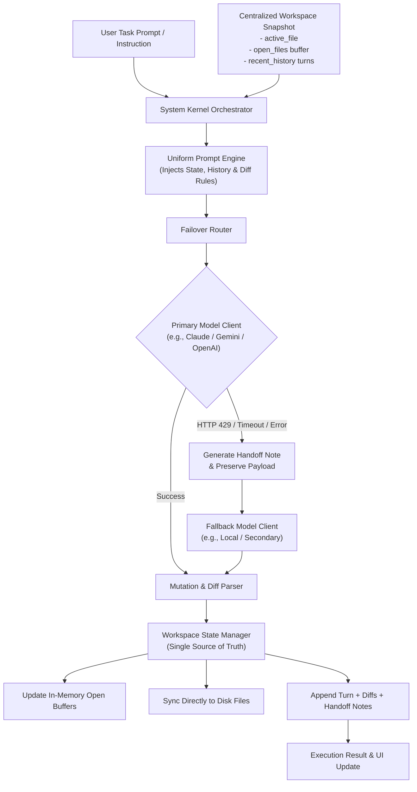

# System Kernel: Multi-Model Developer Environment & Orchestrator

A production-grade, zero-context-drift developer environment and system kernel designed to orchestrate plug-and-play AI models (local open-weights and cloud APIs), eliminate manual copy-pasting via automatic state mutation, and guarantee seamless failovers during rate limits (HTTP 429), timeouts, or server errors.

---

## Key Features

1. **Single Source of Truth (Centralized Workspace State)**
   - Eliminates isolated, drifting chat histories.
   - All files, active code buffers, temporal interaction turns, and execution diffs are read from and written back to a single `WorkspaceSnapshot` payload.
2. **Dynamic Model Agnosticism**
   - Uniform prompt construction and state handling whether backed by local open-weight runtimes (Ollama, vLLM, llama.cpp) or cloud providers (Gemini, Anthropic, OpenAI, Groq, OpenRouter).
3. **Transparent Failover & Circuit Breaker Engine**
   - Automatically catches HTTP 429 (Rate Limit Exceeded), HTTP 408 (Timeouts), and server errors.
   - Enforces a resilient **Circuit Breaker** (`CLOSED`, `OPEN`, `HALF_OPEN`) with configurable cooldowns (e.g. 60s) to avoid hammering degraded providers.
   - Instantly routes the exact same `workspace_snapshot` and task payload to designated fallback models with concise handoff notes.
4. **Pre-Commit In-Memory Syntax Validation & Security**
   - Syntax validation (`ast.parse` for Python, `json.loads` for JSON, bracket balancing for JS/TS) validates mutations *before* applying to memory buffers or disk, rejecting corrupted code.
   - Strict canonical path traversal protection prevents LLM paths from escaping the project root.
5. **Zero Copy-Pasting (State Mutation Engine)**
   - Parses search/replace blocks (`<<<SEARCH_REPLACE>>>`), full file updates (`<<<FILE_UPDATE>>>`), and deletions (`<<<FILE_DELETE>>>`).
   - Automatically updates open in-memory buffers and synchronizes changes to disk with unified diff tracking and snapshot rollback.
6. **Automated Test Verification & Dual Developer Interfaces**
   - Optional automated test execution post-mutation (`auto_verify=True`).
   - **Interactive CLI / TUI REPL** (`run_cli.py`) with rich terminal colors, slash commands, and snapshot inspection.
   - **Full-Featured Web IDE** (`run_server.py`) with 3-column layout: workspace file explorer, live code editor/buffer viewer, chat console, model matrix, circuit breaker reset buttons, test runner, and live HTTP 429 simulation toggle.

---

## Architectural Workflow



---

## Data Contracts

### 1. Input Execution Payload
```json
{
  "task_prompt": "Fix calculation in math_utils.py and add unit test",
  "workspace_snapshot": {
    "active_file": "math_utils.py",
    "open_files": {
      "math_utils.py": "def calculate_metrics(items):\n    # TODO: Implement\n    pass\n"
    },
    "recent_history": [
      {
        "turn_id": "turn_001",
        "role": "user",
        "content": "Initial scaffolding",
        "timestamp": "2026-11-17T19:00:00"
      }
    ],
    "metadata": {}
  }
}
```

### 2. Output Execution Result
```json
{
  "status": "failover_success",
  "task_prompt": "Fix calculation in math_utils.py",
  "response_text": "I analyzed the workspace snapshot and implemented calculate_metrics.",
  "model_used": "fallback-mock",
  "handoff_notes": [
    "[HANDOFF NOTE]: Model 'primary-mock' encountered HTTP 429 Rate Limit. Seamlessly routing to fallback model. Snapshot context preserved."
  ],
  "mutations_applied": [
    {
      "action": "replace_block",
      "file_path": "math_utils.py",
      "diff": "--- a/math_utils.py\n+++ b/math_utils.py\n...",
      "success": true
    }
  ],
  "updated_snapshot": { ... },
  "latency_seconds": 0.015
}
```

---

## Repository Structure

```
gauntlet/
├── kernel/
│   ├── types.py            # Pydantic schemas (WorkspaceSnapshot, ExecutionPayload, Turn, etc.)
│   ├── state_manager.py    # Single Source of Truth state controller & smart block replacement
│   ├── prompt_engine.py    # Uniform prompt construction for Dynamic Model Agnosticism
│   ├── mutation_parser.py  # Structured code mutation parser (search/replace, update, delete)
│   ├── router.py           # Multi-model Failover Router with handoff notes
│   ├── engine.py           # SystemKernel orchestrator entrypoint
│   └── models/
│       ├── base.py         # BaseModelClient abstract class & custom exceptions (429, timeout)
│       ├── mock_client.py  # Controllable mock client with 429/timeout simulation
│       ├── http_clients.py # OpenAI, Anthropic, Gemini, and Ollama clients
│       └── __init__.py     # ModelRegistry & default model factory
├── cli/
│   └── main.py             # Interactive CLI developer REPL
├── server/
│   ├── app.py              # FastAPI REST API & static web serving
│   └── static/             # Modern IDE Web UI (HTML5, CSS3, JavaScript)
│       ├── index.html
│       ├── style.css
│       └── app.js
├── tests/
│   ├── test_kernel.py      # Unit tests (state manager, failover router, parser)
│   ├── test_integration.py # End-to-end integration workflow tests
│   └── run_all_tests.py    # Unified test runner
├── demo_workspace/         # Sample workspace with files for demonstration
│   ├── main.py
│   └── math_utils.py
├── run_cli.py              # Launch interactive CLI
├── run_server.py           # Launch Web Developer Environment
└── README.md
```

---

## Getting Started

### 1. Run All Tests
```bash
python tests/run_all_tests.py
```
Outputs:
```text
test_full_lifecycle (test_integration.TestIntegrationWorkflow) ... [HANDOFF NOTE]: Model 'primary-mock' encountered HTTP 429 Rate Limit. Seamlessly routing to fallback model. Snapshot context preserved. ok
test_transparent_failover_on_429 (test_kernel.TestFailoverRouter) ... ok
test_timeout_failover (test_kernel.TestFailoverRouter) ... ok
test_block_replacement_mutation (test_kernel.TestWorkspaceStateManager) ... ok
...
Ran 10 tests in 0.036s - OK
```

### 2. Launch Interactive Developer CLI
```bash
python run_cli.py demo_workspace
```

Inside the CLI, you have instant access to:
- `/status` : Inspect workspace snapshot, active file, and model fallback chain.
- `/open <file>` : Open a file into state buffers and mark it active.
- `/files` : List project files and open buffers.
- `/models` : View registered models and priorities.
- `/simulate-429` : Toggle simulated HTTP 429 rate limit on the primary model.
- `/undo` : Rollback state snapshot and restore file buffers.
- `/snapshot` : View the raw centralized JSON state snapshot.
- Or type any coding prompt (e.g. `Fix calculation in math_utils.py`).

### 3. Launch Web Developer Environment
```bash
python run_server.py
```
Open your browser at `http://127.0.0.1:8000`:
- **Workspace Explorer** on the left with open buffers.
- **Active Code Buffer Editor** in the middle with instant synchronization.
- **Execution Console** on the right with turn-by-turn chat history.
- **Simulate HTTP 429 Button** in the top navigation to test transparent failover live.
- **State Snapshot Inspector** tab to watch the Single Source of Truth in real time.
- **Models & Failover Matrix** tab to configure models and failover priorities.

---

## Verification of Core Requirements

| Architectural Core Rule | Implementation Details | Verified By |
| :--- | :--- | :--- |
| **1. Single Source of Truth** | All buffers, active files, and history turns managed in `WorkspaceSnapshot` by `WorkspaceStateManager`. No isolated chat drift. | `test_open_and_active_file`, `test_rollback` |
| **2. Dynamic Model Agnosticism** | Uniform prompt construction via `PromptEngine`; plug-and-play registry supporting local open-weights (Ollama) & cloud APIs. | `test_parse_block_replacement`, `test_kernel.py` |
| **3. Transparent Failover & Handoff** | Router catches HTTP 429 & timeouts, routes identical snapshot payload to fallback models, and logs handoff notes. | `test_transparent_failover_on_429`, `test_timeout_failover`, `test_integration.py` |
| **4. Zero Manual Copy-Pasting** | Surgical `<<<SEARCH_REPLACE>>>` and `<<<FILE_UPDATE>>>` mutations automatically applied to buffers and written to disk. | `test_block_replacement_mutation`, `test_full_lifecycle` |
